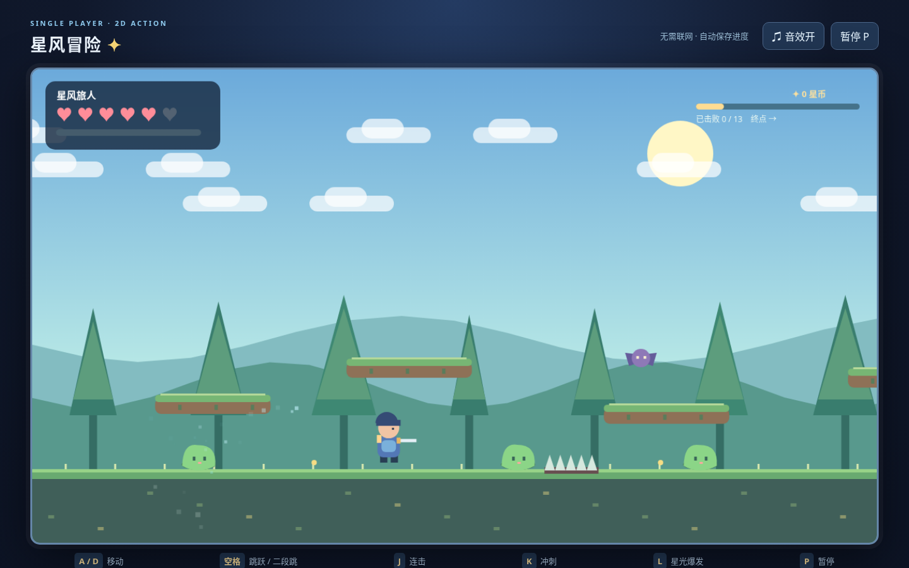
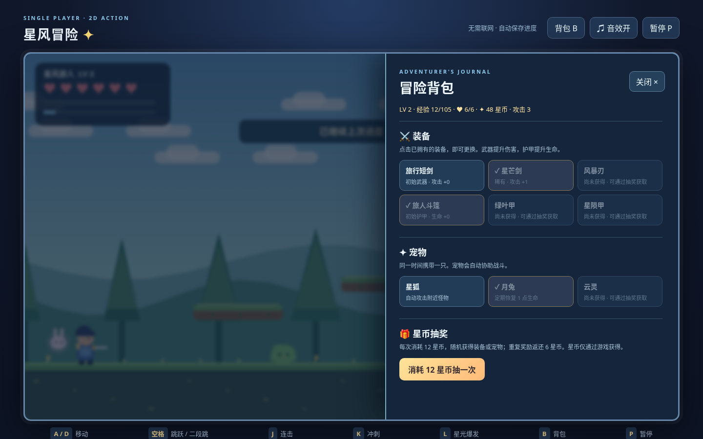
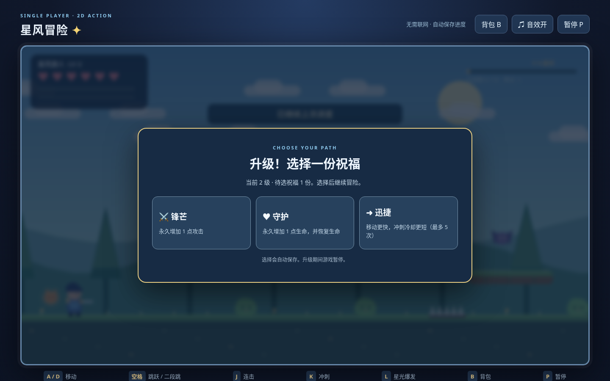

# 星风冒险

原创的单机横版 2D 动作小游戏。电脑上直接双击 `index.html` 即可玩；也可以在本目录运行 `python -m http.server 8000`，打开 `http://localhost:8000`。没有依赖、账号或联网请求。

| 按键 | 操作 |
| --- | --- |
| A / D 或 ← / → | 左右移动 |
| 空格、W 或 ↑ | 跳跃、二段跳 |
| J | 连击 |
| K | 冲刺，短暂无敌 |
| L | 星光满格后释放范围爆发 |
| B | 打开 / 关闭冒险背包 |
| P | 暂停 / 继续 |

穿过云杉谷地，击败守门巨灵后进入星门。击败怪物可获得经验、星币；升级可逐步提升攻击和生命。背包里能更换武器、护甲、宠物。初始宠物星狐会自动攻击，另两种宠物分别提供治疗和星光能量。每次抽奖消耗 12 枚游戏内星币，随机得到装备或宠物；重复奖励返还 6 枚。各奖品概率显示在背包内。没有付费入口。

沿途旗帜是复活点；等级、星币、装备、宠物和关卡进度保存在当前浏览器的 `localStorage`。通关后重开会保留成长、重置关卡。音效可在页面右上角关闭。游戏使用 Canvas 绘制原创场景和角色，没有使用《冒险岛》的素材或角色。

## 设计借鉴

- 借鉴平台动作游戏的宽容输入：跳跃有短暂的预输入和离台宽限，减少“明明按了却没跳起来”的挫败感。
- 借鉴动作 roguelike 的升级选择：每次升级从攻击、生命、机动性三种祝福中选一项，让同一关卡也能尝试不同打法。祝福永久保存。
- 借鉴经典首领战的可读性：守门巨灵在发射弹幕前会出现红色预警线，玩家可以跳跃或冲刺躲避。

这些机制按本作的节奏和数值重新实现；素材、角色和代码均为本项目原创。

## 开发

页面、样式和游戏逻辑分别位于 `index.html`、`style.css`、`game.js`。修改后刷新页面即可看到效果。
