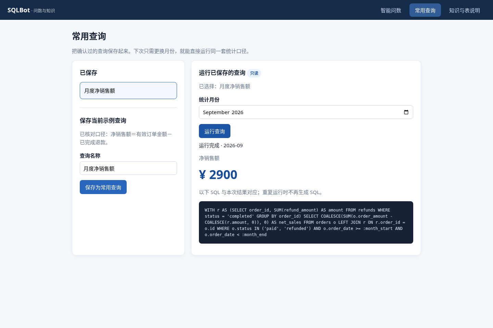

# SQLBot 问数与知识项目（独立版）

这是一个**独立仓库**，不依赖 `CustomerOperationsManagement`。项目使用原版 [SQLBot](https://github.com/dataease/SQLBot) 提供智能问数，用一个本地入口展示知识与表说明，并保存、参数化重跑经过核对的 SQL 模板。演示数据全部为合成数据。

**当前智能问数并非无 RAG：**原版 SQLBot 会按问题匹配数据源、表、术语和 SQL 示例，再把匹配内容交给模型。`knowledge/*.md` 目前只是项目内的底稿与页面说明，不会自动加入模型 prompt。如果要求全部表结构与小篇幅知识每次直接放入 prompt，需要把智能问数链路改为 prompt-only；不能把当前 SQLBot 页面当成已实现的 prompt-only 版本。



## 在公司电脑启动

需要 Docker Desktop（或 Docker Engine）、Python 3.10+。首次启动需要网络拉取 SQLBot 镜像和 Python 依赖。

```bash
python bootstrap.py
python -m venv .venv
# macOS/Linux: source .venv/bin/activate
# Windows PowerShell: .venv\Scripts\Activate.ps1
python -m pip install -r requirements.txt
docker compose up -d
python app.py
```

浏览器打开 **http://127.0.0.1:8000/saved/**。顶部有“智能问数”“常用查询”“知识与表说明”三个入口。SQLBot 首次登录账号为 `admin`，密码在本地 `.env` 的 `DEFAULT_PWD`。这些密码由 `bootstrap.py` 随机生成，`.env` 已排除在 Git 之外。

第一次进“智能问数”需要在 SQLBot 管理页配置模型和数据源；没配置模型时，可以先在“常用查询”点一次“查询”，确认结果后再点“保存到常用”，不必填名称。默认月份是上一个完整月；演示数据在 2026-09 可得到 `2900`，2026-10 为 `0`。`queries/net_sales_monthly.json` 默认执行本地 `data/demo.sqlite`。这条查询与 SQLBot 的数据源是**两条独立配置**；要查公司数据，两边须指向同一套经过授权的只读表或视图。

## 改成公司数据

1. 在 SQLBot 的“系统管理 → AI 模型管理”配置公司允许使用的模型。API Key 只填在运行环境，不要放进仓库。
2. 在 SQLBot“数据源”添加公司只读报表库，并只选择允许业务用户查询的表或视图。补齐表、字段说明及表关联。
3. 在本地 `.env` 追加 `QUERY_DATABASE_URL=postgresql://只读用户:密码@主机:5432/库名`，或使用 `mysql://...`。连接串中的特殊字符需 URL 编码。**运行常用查询的账号必须在数据库侧只读**。修改后重启 `python app.py`。
4. 把 `queries/net_sales_monthly.json` 中的 SQL 换成公司实际表名和已确认口径。SQL 使用 `:month_start`、`:month_end` 绑定参数，绝不要拼接用户输入。若不需要此查询，可复制 JSON 改成另一条经过核对的查询。
5. 按 [知识录入说明](knowledge/README.md)整理业务知识，并在 SQLBot 管理页维护术语、SQL 示例、表和字段描述。项目页面的“知识与表说明”可直接阅读这些文件；**文件内容不会自动同步到 SQLBot 模型上下文**。

数据库类型、schema、指标口径是公司特有信息，需要你们确认。当前网关支持 SQLite、PostgreSQL、MySQL 的常用查询；SQLBot 可配置其自身支持的数据库。常用查询 SQL 只能通过修改项目文件维护，网页中只能选择、保存和填参数。

## 项目结构

| 文件 | 作用 |
| --- | --- |
| `compose.yaml` | 固定版本 SQLBot v1.10.2，数据写入 Docker 卷 |
| `app.py`、`public/index.html` | 同一浏览器入口：SQLBot、常用查询、知识浏览 |
| `query_runner.py` | 绑定参数、只读执行、限制结果行数 |
| `queries/*.json` | 经审核的可重跑 SQL 模板 |
| `knowledge/*.md` | 表字段、指标口径、FAQ、SQL 示例的可修改模板 |
| `bootstrap.py` | 生成本地随机密码和合成订单数据 |

停止服务：在 `python app.py` 的终端按 Ctrl+C，再执行 `docker compose stop`。备份时保留本地 `.env`、`data/` 和 SQLBot Docker 卷；不要把这些文件上传到公开仓库。

这是便于内部评估和改造的起点，尚未提供网关自己的登录与用户权限。默认只监听 `127.0.0.1`；若要让同事通过公司网络共同使用，需要先把网关接入公司的认证与权限系统。SQLBot 的二次开发和品牌使用应遵守其上游许可证。
