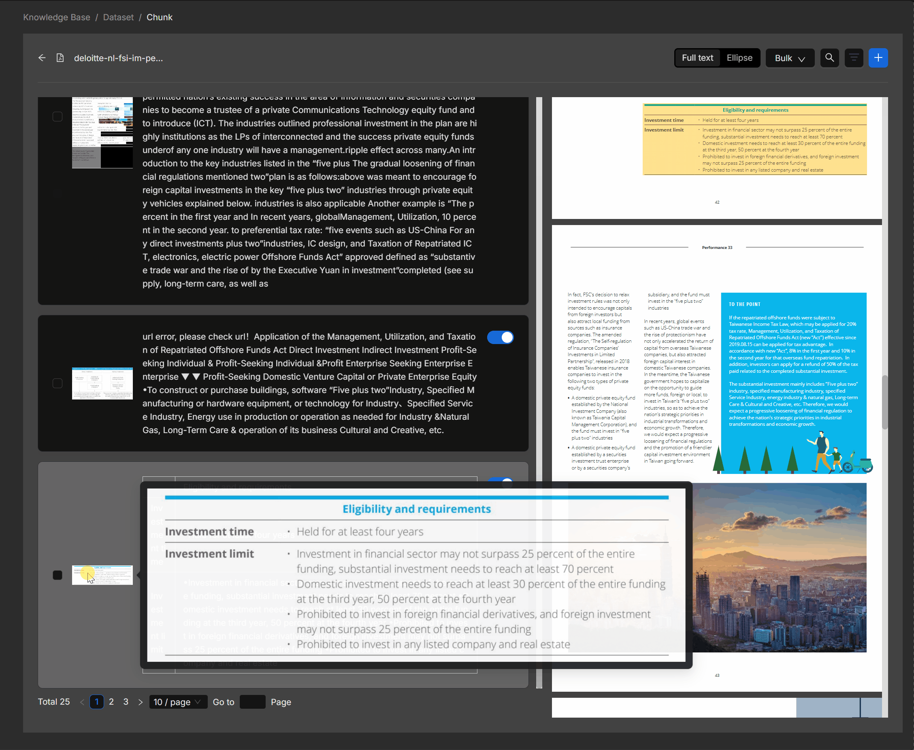
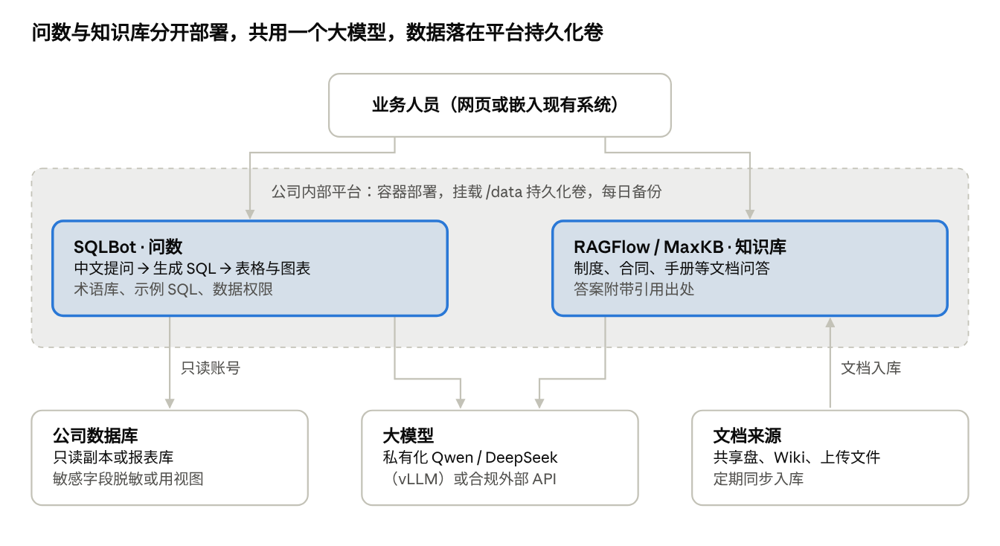

# NL2SQL 与知识库问答开源工具调研

调研日期：2026-10-12

## 结论速览

推荐先用 **SQLBot（问数）+ RAGFlow 或 MaxKB（知识库）** 做 POC，两周内用真实问题评估准确率后再定型；如果希望一个平台包揽问数和知识库，备选 DB-GPT。

| 需求 | 首选 | 备选 | 理由 |
| --- | --- | --- | --- |
| 业务人员用中文问公司数据库 | SQLBot | DB-GPT | SQLBot 开箱即用、自带数据权限与术语库；DB-GPT 为 MIT 许可、能力更全但更重 |
| 指标口径统一的数据分析 | WrenAI | — | 语义层先定义“活跃客户”等口径，再生成 SQL |
| 复杂文档知识库问答 | RAGFlow | FastGPT | 文档解析与引用溯源最强，Apache 2.0 |
| 轻量部门问答助手 | MaxKB | AnythingLLM | 单容器 + 一个数据卷，最契合平台的 `/data` 约定 |
| 公司级 AI 应用中台 | Dify | — | 工作流 + 知识库 + API，可编排 SQLBot 等工具 |

不建议新项目采用 Vanna 0.x：原仓库已于 2026-03-29 归档。

## NL2SQL 开源工具对比

面向“业务人员用中文问数据库”，首选 SQLBot（开箱即用、带权限）或 DB-GPT（功能全、MIT）；要做严格口径治理选 WrenAI；Vanna 原仓库已于 2026-03-29 归档，新项目不建议再用 0.x。

| 工具 | Star（约） | 许可证 | 形态 | 核心特点 | 适合场景 |
| --- | --- | --- | --- | --- | --- |
| [SQLBot](https://github.com/dataease/SQLBot)（飞致云 DataEase） | 6.9k | FIT2CLOUD 开源许可（GPLv3 + 附加限制：不得改 Logo/版权） | Docker 一键部署，支持离线安装包 | 问数 + 自动出图；术语库、SQL 示例库持续调优；工作空间隔离与细粒度数据权限；可嵌入网页，支持 MCP，能对接 Dify/MaxKB/DataEase | 内部 ChatBI 快速上线，中文场景 |
| [DB-GPT](https://github.com/eosphoros-ai/DB-GPT)（蚂蚁开源社区） | 20.1k | MIT | pip / Docker / 源码，支持 vLLM、llama.cpp 本地模型 | Text2SQL + Python 沙箱执行 + 图表报表；同时带 RAG 知识库与 Agent 工作流；可用 DB-GPT-Hub 微调 Text2SQL 模型 | 想要“问数 + 知识库 + 分析报告”一体平台，愿意投入部署调优 |
| [WrenAI](https://github.com/Canner/WrenAI) | 17.8k | 核心 Apache 2.0（仓库同时含 AGPL-3.0 文件，需按组件确认） | `pip install wrenai` + CLI / MCP；原 Docker 版 GenBI 已转入 `legacy/v1` 不再更新 | 语义层（MDL）先定义指标口径再生成 SQL；执行前 dry-plan 校验、行数限制；22+ 数据源 | 指标口径严格、多人共用的数据团队；适合给 Agent 当“问数工具” |
| [Vanna](https://github.com/vanna-ai/vanna) | 23.8k | MIT | Python 库 | 用表结构、示例 SQL 训练检索；2.0 改为 Agent 架构，带行级权限、审计日志 | 原仓库 2026-03-29 已归档只读；仅适合已有存量项目 |
| [Chat2DB](https://github.com/CodePhiliaX/Chat2DB) | 28.3k | 5.3.0 起为基于 Apache 2.0 的附加条件“源码可见”许可，5.3.0 前为 Apache 2.0 | 桌面 / Docker Web / CLI | 偏开发者的 AI 数据库客户端：生成、解释、优化 SQL；支持 40+ 数据库 | 给开发、DBA 用的 SQL 助手，不是给业务人员的问数产品 |

Star 数为 2026-10 抓取 GitHub 页面所得，仅作热度参考。

## 知识库问答（RAG）开源平台对比

文档复杂（扫描件、表格多的 PDF）选 RAGFlow；要把问答做成带工作流的应用并开放 API 选 Dify；要最轻、一个容器就能跑选 MaxKB。

| 工具 | Star（约） | 许可证 | 部署与资源 | 核心特点 | 适合场景 |
| --- | --- | --- | --- | --- | --- |
| [RAGFlow](https://github.com/infiniflow/ragflow) | 92.0k | Apache 2.0 | Docker Compose；建议 4 核 / 16 GB / 50 GB；依赖 MySQL、MinIO、Elasticsearch 或 Infinity 等；1.0.0-rc1（2026-09-29） | DeepDoc 版面分析、OCR、表格识别；答案带出处引用并可人工校对切片；多步检索 Agent | 制度、合同、产品手册等复杂文档问答，重视准确和可追溯 |
| [Dify](https://github.com/langgenius/dify) | 158.2k | Dify 开源许可（Apache 2.0 + 附加条件，多租户、改 Logo 前需看 LICENSE） | Docker Compose；最低 2 核 / 4 GB | 可视化工作流 + RAG + Agent + 模型管理；每个应用自带 API；支持 MCP | 把知识库、问数、业务流程组合成 AI 应用，当公司 AI 中台 |
| [FastGPT](https://github.com/labring/FastGPT) | 29.8k | FastGPT 开源许可：可商用作后端，不得作为 SaaS 对外提供，需保留版权 | Docker Compose | 混合检索 + 重排；检索测试、全链路日志、对话标注；工作流与 MCP | 中文知识库问答，需要精细调检索效果 |
| [MaxKB](https://github.com/1Panel-dev/MaxKB)（飞致云） | 22.9k | GPL-3.0 | 单个 Docker 容器 + 一个数据卷；提供离线安装 | 上传 / 爬取文档自动切分向量化；工作流与 MCP；低代码嵌入第三方系统；可与 SQLBot 互嵌 | 快速做部门级问答助手，运维最省事 |
| [Open WebUI](https://github.com/open-webui/open-webui) | 154.4k | Open WebUI 许可（须保留“Open WebUI”品牌） | pip / Docker / K8s；数据卷挂 `/app/backend/data`，可用 PostgreSQL | 通用聊天门户；混合检索、多种向量库与 OCR 提取 | 先给全公司一个统一的 AI 聊天入口，知识库是附带能力 |
| [AnythingLLM](https://github.com/Mintplex-Labs/anything-llm) | 67.0k | MIT | 桌面版或 Docker（多用户权限仅 Docker 版有） | 拖拽上传、带引用的文档问答；默认 LanceDB；Agent 与 MCP | 小团队或个人试用，许可最宽松 |

## 效果展示

大模型已经能把常见的业务问题直接变成可执行的 SQL；公开榜单上最好的系统约 80% 答对，人类专家约 93%，剩下的差距主要靠术语库和示例 SQL 补。

### 问数实测：5 个中文问题 → SQL → 结果

示例库为模拟的客户运营数据（200 个客户、1,250 笔订单、524 张工单，SQLite）。SQL 由大模型（Claude）根据表结构生成，结果为在示例库上的实际执行输出；SQLBot、DB-GPT 等工具接入大模型后，就是把这一步做成了界面并自动出图。复现脚本见 [demo/](demo/)。

| 业务问题 | 难度 | 生成的 SQL 要点 | 执行结果 |
| --- | --- | --- | --- |
| 华东区的 VIP 客户有多少个？ | 单表过滤 | `WHERE region='华东' AND level='VIP'` | 13 个 |
| 2026 年每个季度的成交额（不含退款）？ | 分组聚合 | 按月份换算季度，`status='已完成'` 排除退款 | Q1 145.9 万 · Q2 131.1 万 · Q3 146.8 万 · Q4（截至 10 月初）7.6 万 |
| 今年哪类工单平均解决时间最长？ | 聚合 + 排序 | 只统计已解决工单，`AVG(resolve_hours)` | 质量类 52.4 小时，其次物流 50.0、退款 49.2、咨询 43.2 |
| 最近 90 天没下过单的 VIP 客户？ | 关联 + 日期计算 | `LEFT JOIN` 保留从未下单的客户，`HAVING` 判断最近下单日 | 26 个，其中 3 个从未下单（客户047、128、165） |
| 成交额前 5 的客户各有几张未解决工单？ | 跨三表 | 订单汇总排序 + 工单子查询 | 客户075（14.6 万，0 张）、客户139（12.6 万，1 张）等 |

第 4 题生成的完整 SQL：

```sql
SELECT c.name AS 客户, c.region AS 区域, MAX(o.order_date) AS 最近下单日
FROM customers c LEFT JOIN orders o ON o.customer_id = c.id
WHERE c.level = 'VIP'
GROUP BY c.id
HAVING 最近下单日 IS NULL OR 最近下单日 < date('2026-10-12', '-90 day')
ORDER BY 最近下单日;
```

容易出错的地方是口径：“成交额”是否含退款、“活跃客户”怎么算，模型只能猜。把这些定义写进 SQLBot 的术语库或 WrenAI 的语义层，是准确率从“能用”到“可信”的关键。

### 公开榜单上的准确率

| 评测 | 测什么 | 当前最好成绩 | 对照 |
| --- | --- | --- | --- |
| [BIRD](https://benchmarklist.com/benchmarks/bird_sql/) | 95 个真实数据库、带脏数据和业务知识的问数 | 约 80–82%（Gemini-SQL2 报 80.04%，[来源](https://aiweekly.co/alerts/googles-gemini-sql2-tops-bird-text-to-sql-at-8004)） | 人类专家 92.96% |
| [Spider 2.0-Lite](https://github.com/xlang-ai/Spider2) | 企业级数仓：上百张表、多步分析 | 约 72–76%（[Oracle 报 72.02%](https://blogs.oracle.com/cloud-infrastructure/oci-gen-ai-tops-spider-2-lite)） | 说明复杂数仓仍需人工复核 |

榜单成绩多为厂商自报，各来源数字有出入，仅用来判断量级；在公司数据上的真实效果以 POC 为准。

### 知识库：RAGFlow 解析复杂文档



截图来自 [RAGFlow 官方演示](https://github.com/infiniflow/ragflow)：右侧是原始 PDF，左侧是解析后的切片，“Eligibility and requirements”表格被完整识别成一个切片。提问时答案会引用这些切片，点击可回到原文位置核对。

## 选型建议与落地架构

问数和知识库分成两个服务部署在公司平台上，共用一个大模型；它们自带的配置库、向量库和上传文件都写进平台的 `/data` 持久化卷。



SQLBot 只通过只读账号访问数据库副本，知识库只读入同步过来的文档。需要统一入口时，可以再用 Dify 把两者编排成一个对话应用。

- 部署：两者都提供 Docker 镜像，按平台约定挂载 `/data`，副本数先固定为 1。
- 资源：RAGFlow 建议 4 核 / 16 GB；资源紧张就先用 MaxKB（单容器）。
- 模型：先用一个模型跑通，POC 后再按准确率和成本决定是否私有化部署。

## 风险与注意事项

NL2SQL 最大的风险是“看起来对、实际错”的 SQL，其次是越权查询；两者都要在数据库层兜底，不能只靠提示词。

- **只读账号**：给问数工具单独开只读账号，最好连只读库或报表库，禁止 INSERT/UPDATE/DELETE/DDL。
- **权限边界**：只暴露需要的表和字段（可建专用视图）；手机号、证件号等敏感字段脱敏或不暴露；按部门配置行级权限。
- **查询保护**：设置超时与返回行数上限，避免大查询拖垮业务库。
- **准确率**：对外展示生成的 SQL 与口径说明；通过术语库、字段注释、常见问题的标准 SQL 持续调优。表和字段没有中文注释的，先补注释。
- **数据不出域**：客户数据会随提示词发给大模型。用外部 API 前确认合规；否则用私有化模型（如 Qwen、DeepSeek 经 vLLM 部署）。
- **许可证**：SQLBot、MaxKB（GPL 系）、Dify、FastGPT、Open WebUI、Chat2DB 均有品牌或 SaaS 限制；公司内部自用通常没问题，若要二次开发后对外提供，先让法务看 LICENSE。
- **持久化**：这些工具都自带数据库、向量库和文件存储，部署到平台时同样要挂持久化卷并纳入备份。

## POC 验证计划

用公司自己的问题和数据打分，而不是看榜单；每个工具用同一套题目对比。

1. 准备题库：从业务方收集 30–50 个真实问数问题（由易到难），每题写好标准 SQL 和答案；再收集 30 个知识库问题及标准答案和出处。
2. 准备数据：用公司数据库的只读副本或脱敏副本；挑一批真实文档（含扫描件、表格）。
3. 在平台上各部署一套 SQLBot、DB-GPT、RAGFlow、MaxKB，统一接同一个大模型。
4. 做一轮基础配置（补字段注释、术语库、示例 SQL）后跑题库，记录结果。
5. 请 3–5 名业务同事试用一周，收集反馈，定型。

| 指标 | 衡量方式 | 建议门槛 |
| --- | --- | --- |
| 问数执行准确率 | 结果与标准答案一致的题目占比 | 常见问题 ≥ 85% |
| 知识库答案正确率 | 人工判定答案正确且引用出处正确 | ≥ 80% |
| 响应时间 | 从提问到出结果 | ≤ 15 秒 |
| 权限隔离 | 用低权限账号尝试越权提问 | 0 次泄露 |
| 部署与运维成本 | 容器数、CPU/内存、升级难度 | 定性评估 |

门槛为建议值，可按业务容忍度调整。

## 参考来源

以下 GitHub 页面均于 2026-10-12 抓取。

- [SQLBot](https://github.com/dataease/SQLBot) · [DB-GPT](https://github.com/eosphoros-ai/DB-GPT) · [WrenAI](https://github.com/Canner/WrenAI) · [Vanna](https://github.com/vanna-ai/vanna) · [Chat2DB](https://github.com/CodePhiliaX/Chat2DB)
- [RAGFlow](https://github.com/infiniflow/ragflow) · [Dify](https://github.com/langgenius/dify) · [FastGPT](https://github.com/labring/FastGPT) · [MaxKB](https://github.com/1Panel-dev/MaxKB) · [Open WebUI](https://github.com/open-webui/open-webui) · [AnythingLLM](https://github.com/Mintplex-Labs/anything-llm)
- 综述：[Wren AI vs Vanna AI](https://querio.ai/articles/wren-ai-vs-vanna-ai-open-source-text-to-sql-compared) · [Open Source AI Agent Platform Comparison (2026)](https://jimmysong.io/blog/open-source-ai-agent-workflow-comparison/) · [Best Open Source RAG Frameworks in 2026](https://www.olostep.com/blog/open-source-rag-frameworks)
