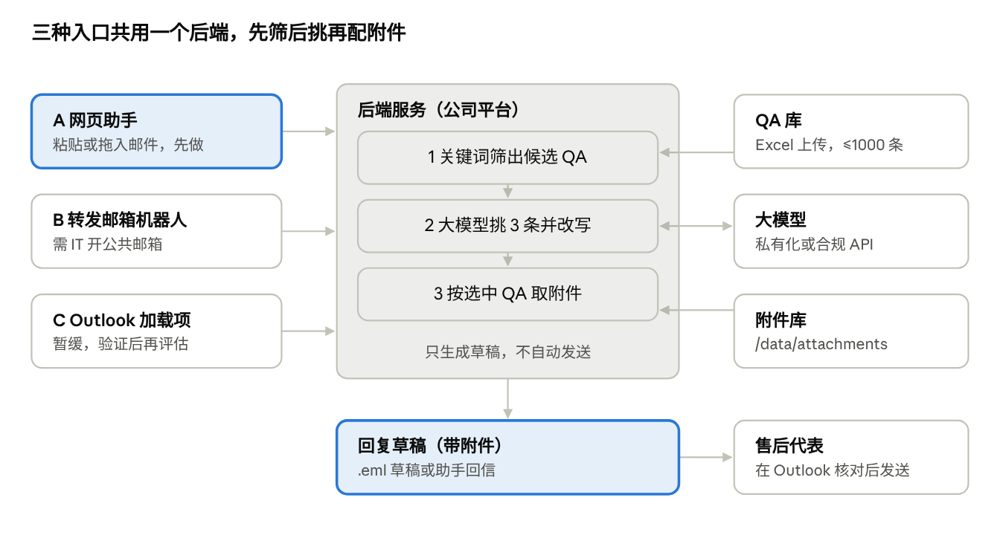

# 售后邮件智能回复助手方案

方案日期：2026-10-13

## 结论

推荐先做一个**部署在公司平台上的网页助手**：售后代表把客户邮件粘贴或拖进网页，得到 3 条候选回复和匹配的附件，一键生成带附件的邮件草稿在 Outlook 里打开。它不需要在 Outlook 里安装任何东西，也不需要 IT 推送加载项。IT 愿意开一个公共邮箱时，再加“转发即得草稿”入口。

| 接入方式 | 售后代表怎么用 | 需要 IT 做什么 | 自动带附件 | 建议 |
| --- | --- | --- | --- | --- |
| A. 网页助手 | 复制邮件正文或拖入邮件文件 → 选一条回复 → 下载草稿双击打开 | 无（平台内部署即可） | 是，草稿里已带附件 | **第一步做** |
| B. 转发邮箱机器人 | 把客户邮件转发给助手邮箱 → 1 分钟内收到带 3 条候选和附件的回信 | 开一个公共邮箱并给程序收发权限 | 是，回信里带附件 | IT 同意后作为第二入口 |
| C. Outlook 加载项 | 在 Outlook 侧边栏直接操作 | 管理员集中部署，且受 Outlook 版本限制 | 是 | 暂缓，等 A 验证有效后再评估 |

三种入口共用同一个后端、QA 库和附件库，从 A 加 B 或 C 都不用重做。

## 推荐方案：网页助手

一封邮件从打开到回复草稿就绪，售后代表只需要 5 步，全程由人确认后才发送。

1. **放入邮件**：在 Outlook 里复制客户邮件正文粘贴到网页；或把邮件另存为 .msg / .eml 文件拖进来，系统自动读取发件人、主题和正文。
2. **看候选**：页面显示识别出的需求类别和关键词，以及 3 条候选回复。每条标注依据的 QA 编号；若涉及需要其他机构确认的内容，会提示“需向 XX 部门确认”。
3. **选一条并修改**：在网页里直接编辑正文。
4. **选择是否带附件**：勾选“带附件”后，系统列出匹配的文件（如《回收流程说明.pdf》），可以增减。
5. **生成草稿**：点“生成邮件”下载一个 .eml 草稿，双击即在 Outlook 里打开为待发送邮件，收件人、“RE: 原主题”、正文和附件都已填好，核对后发送。

打不开 .eml 草稿的 Outlook 版本，用备用办法：点“复制正文”和“下载附件”，在 Outlook 里点回复后粘贴、拖入附件，多花约 10 秒。

## 系统架构

后端部署在公司平台上，QA 库和附件库都存在平台的 `/data` 持久化卷里；入口只负责拿到邮件和交付草稿，换入口不影响后端。

## QA 库与附件库设计

QA 库用一张 Excel 维护，售后同事改完在网页后台上传即生效；附件集中放在平台的 `/data/attachments`，不从个人电脑取文件，保证所有人发出的都是同一份最新版。

| 字段 | 必填 | 示例 | 用途 |
| --- | --- | --- | --- |
| 编号 | 是 | HS-012 | 候选回复上标注依据 |
| 类别 | 是 | 回收类 | 服务资源 / 回收 / 大数据合作 / 维护保养等 |
| 关键词 | 是 | 回收、以旧换新、报废、残值 | 第一步筛选，多个用顿号分隔 |
| 典型问题 | 是 | 客户咨询旧设备回收流程和估价 | 让大模型判断是否对题 |
| 参考答案 1 / 2 / 3 | 至少 1 条 | 标准版 / 简洁版 / 待确认版 | 候选回复的来源，大模型只改称呼和细节 |
| 附件 | 否 | 回收流程说明.pdf、回收申请表.xlsx | 按文件名从附件库取文件 |
| 适用条件 | 否 | 仅限质保期外设备 | 不满足时提示用户 |
| 确认机构 | 否 | 回收业务部 | 提示“需向 XX 确认” |
| 更新人 / 更新时间 | 是 | 张三 / 2026-10-10 | 超过 6 个月未更新的条目提醒复核 |

上传时系统校验：必填项是否缺失、附件文件名是否在附件库里存在、关键词是否和其他条目大量重复，有问题先报错不生效。

## 匹配逻辑（不用 RAG）

1000 条以内的 QA 用“先筛后挑”两步就够了，结果可解释，QA 库一改立即生效，不需要向量库。

1. **关键词筛选**：用邮件主题和正文匹配 QA 库的关键词，按命中数量排序，取前 30 条候选。
2. **兜底分类**：一条都没命中时，让大模型先判断邮件属于哪个类别，把该类别下的全部条目作为候选。
3. **大模型挑选改写**：把客户邮件和候选 QA 一起发给大模型，要求它选出最匹配的 3 条，并只在参考答案基础上改称呼、型号、时间等细节，不得编造政策或价格。
4. **附件匹配**：直接取被选中 QA 的“附件”列，不让大模型猜。
5. **记录反馈**：记录用户最终选了哪条、改了多少，用来发现要补充或修正的 QA。

## 实施计划与验收指标

约 4 周可以让售后同事用上网页助手，其中前 2 周主要是业务侧整理 QA。

| 阶段 | 内容 | 负责方 | 周期 |
| --- | --- | --- | --- |
| 0. 整理 QA | 高频 100–200 条 QA + 对应附件，按模板填 Excel | 售后团队 | 1–2 周 |
| 1. 网页助手 | 粘贴邮件、出 3 条候选、附件匹配、生成 .eml 草稿、QA 上传后台 | 开发 | 2 周（可与阶段 0 并行） |
| 2. 试用 | 3–5 名售后代表日常使用，收集反馈并补 QA | 售后 + 开发 | 2 周 |
| 3. 扩展入口 | 视 IT 意见加转发邮箱或 Outlook 加载项 | 开发 + IT | 按需 |

试用期验收指标（建议值）：

- 3 条候选中至少有 1 条可用：≥ 80% 的邮件
- 单封邮件回复时间：比试用前减少 50%
- 附件匹配正确率：≥ 90%

## 风险与待确认事项

- **.eml 草稿兼容性**：经典版 Outlook（Windows）可以把带“未发送”标记的 .eml 打开成可编辑草稿；新版 Outlook 和 Mac 版需实测，不行就用“复制正文 + 下载附件”。
- **草稿不在原邮件会话里**：.eml 是一封新邮件，虽然主题是“RE: 原主题”，客户那边一般会归到同一会话，但不带原邮件引文。需要引文的，用备用办法在原邮件上点回复。
- **客户邮件发给大模型**：需确认是否允许用外部模型；不允许就用公司私有化模型。
- **QA 库无人维护**：要指定 QA 库负责人，每月根据反馈更新。
- **登录与权限**：网页助手应接公司统一登录；只有 QA 负责人能上传 QA 和附件。
- **转发邮箱（方式 B）**：需 IT 同意开公共邮箱并授权程序收发，可与阶段 1 同步申请。
